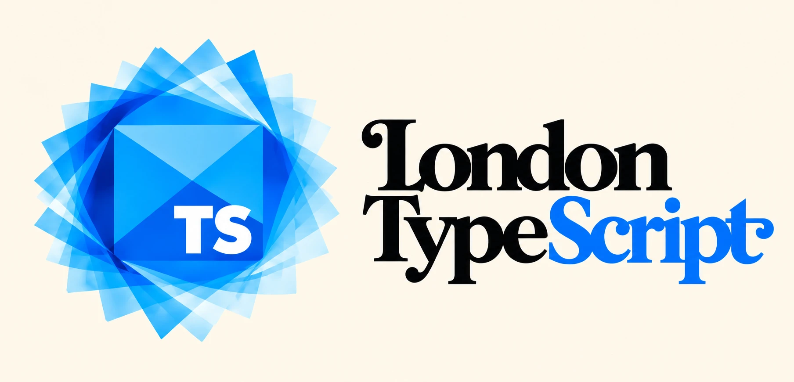

# tate-modern

**The design studio for [London TypeScript](https://github.com/londontypescript)**, the developer meetup. Our visual identity is written as TypeScript, explored side by side in a small studio app, and exported for the website, GitHub and events.

## Where it started

The logo began as a React Three Fiber sculpture made for an earlier version of the meetup's site (March 2026): translucent blue slabs fanned behind a "Ts" tile. ChatGPT then painted a flat logo from it, with the "London TypeScript" wordmark beside it. The studio recreates both in code, so every shape comes from parameters rather than pixels.

<table>
  <tr>
    <td align="center" width="40%"></td>
    <td align="center" width="60%"></td>
  </tr>
  <tr>
    <td align="center">The 3D sculpture</td>
    <td align="center">ChatGPT's flat version</td>
  </tr>
</table>

## The concepts

Each concept is its own renderer of the same idea, sharing one palette and one wordmark:

| Concept | What it is | Exports |
| --- | --- | --- |
| **Flat** | Translucent squares rotated about a faceted tile, as pure 2D SVG. Refined against ChatGPT's version. | SVG (the files in `public/assets/`) |
| **3D** | The original sculpture in React Three Fiber, with real lights and reflections. | PNG |
| **Projected** | The 3D slabs drawn as flat SVG, shaded with three.js's own lighting maths: a vector logo with the sculpture's depth. | SVG |

The TypeScript source is the design: the SVGs in `public/assets/` are generated from it, never edited by hand.

## Quick start

Requires Node 24 or later and pnpm.

```bash
pnpm install
pnpm dev              # the studio at http://localhost:5173
pnpm test             # unit tests (Vitest)
pnpm build            # regenerate assets, type-check, build the studio
```

## Documentation

- [Using the studio](docs/studio/using-the-studio.md): the controls, saved configurations, the generated assets, and using the components in a website.
- [How the concepts work](docs/studio/concepts.md): the geometry, animation, projection and shading behind each concept, and the shared typography.
- [Code layout](docs/studio/architecture.md): the project structure, adding a concept, fonts and tests.

## Why "Tate Modern"

London TypeScript's repositories are named after London landmarks. Tate Modern is London's gallery for modern and experimental art, and this repo is where the meetup's experiments live: prototype designs, tried side by side, that the rest of London TypeScript eventually adopts.

## Licence and credits

[MIT](LICENSE).

- **Fonts:** Open Sans and Playfair Display, both under the SIL Open Font License 1.1, installed from `@fontsource` packages. No font files are committed.
- **three.js:** `src/concepts/projected/engine/shading.ts` ports formulas from three.js's shaders ([MIT](https://github.com/mrdoob/three.js/blob/dev/LICENSE), © 2010-2026 three.js authors).
- **Reference images** (`public/references/`): `chatgpt-original.webp` is the image ChatGPT generated from the sculpture; `flat-mvp.png`, `three-hero.png` and `three-stack.png` are screenshots of this project's own prototypes.
