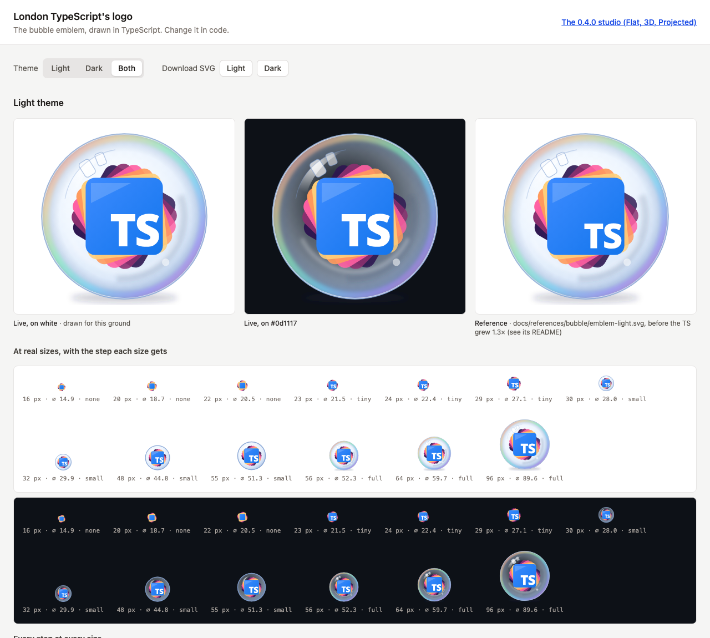

<p><picture>
  <source media="(prefers-color-scheme: dark)" srcset="public/assets/london-typescript-logo-dark.svg">
  
</picture></p>

# tate-modern

**London TypeScript's logo design system, with the logo generated entirely in TypeScript.** The logo is a glass bubble around the TypeScript tile and a fan of sunset-coloured panes, beside the name in Exo 2. Its geometry, colours and lettering are defined in TypeScript rather than drawn, in a light and a dark theme, with simpler drawings for small sizes. A small studio previews it at the sizes it's seen, and `pnpm generate:assets` writes every file GitHub, Meetup and the website need.

## Where it started

The logo began as a concept sculpture hand-coded in three.js with React Three Fiber: translucent blue slabs fanned behind a "Ts" tile. Each slab is its own bevelled 3D mesh in a metallic blue, three-quarters opaque, and each one rotates independently at its own speed, so the fan opens, closes and shifts as it turns.

A rig of directional lights picks out highlights along the bevelled edges, and a bloom pass gives the glass its glow. A hero-page concept spread the turning fan across the page, beside an Ignite button that scrolls on to the next section.

<table>
  <tr>
    <td align="center" valign="middle" width="50%"></td>
    <td align="center" valign="middle" width="50%"></td>
  </tr>
  <tr>
    <td align="center">The 3D hero</td>
    <td align="center">The 3D logo</td>
  </tr>
</table>

We then made 2D mockups from it, with the "London TypeScript" wordmark beside the emblem.

<p align="center"></p>
<p align="center">The 2D mockup the flat logo works towards</p>

The 0.4.0 studio rebuilt both in code, as three concepts side by side: **Flat**, the mockup as pure SVG; **3D**, the sculpture in React Three Fiber; and **Projected**, the 3D slabs drawn as flat SVG with three.js's own shading.

## The bubble

In October 2026 the flat fan was redrawn as a glass bubble: the panes recoloured as sunset bands (plum, magenta, pink, orange and gold) behind the blue TS tile, inside a clear sphere with a rim and highlights, and the name set in Exo 2 with "Script" in TypeScript blue. It became the logo in [ADR 0004](docs/adr/0004-the-bubble-is-the-logo.md), and 0.5.0 built it in TypeScript, judged against the [reference drawings](docs/references/bubble/README.md):

- **Two themes:** light for white pages; dark for GitHub's dark page, with lighter glass, a soft white ground shadow, near-white ink and a lifted blue.
- **Four detail steps:** the full bubble from 56 px; a simpler bubble with a larger TS from 30 px; the fan and tile without the bubble from 23 px; and at favicon sizes the tile and the sunset ring alone.
- **One recipe per place it's shown,** in [`src/bubble/engine/slots.ts`](src/bubble/engine/slots.ts): which drawing, step, background and size each one takes.

## The studio

`pnpm dev` opens the bubble's studio: the emblem large beside its reference, at real sizes with the step each size gets, every step at every size, the lockup, and each place the logo lands, in both themes, with SVG downloads. Nothing is tuned there; the drawing is changed in code.

<p align="center"></p>

The 0.4.0 studio, with the Flat, 3D and Projected concepts, their controls, saved configurations and downloads, is kept unchanged at `legacy.html`, linked from the studio's header. [Using the studio](docs/studio/using-the-studio.md) describes it.

## Assets

`pnpm generate:assets` writes these files to [`public/assets/`](public/assets/), and nothing else; `pnpm build` runs it first, and CI fails if the committed files differ from what it writes. They're generated from the TypeScript, never edited by hand. Every SVG is self-contained, with the lettering as outlines, so it needs no fonts. Projects that use them copy the files they need rather than linking to this repo.

| File                                                                            | What it is                                              | Where it's used                                                       |
| ------------------------------------------------------------------------------- | ------------------------------------------------------- | --------------------------------------------------------------------- |
| `london-typescript-logo-light.svg`<br>`london-typescript-logo-dark.svg`         | The emblem and the stacked name, transparent            | README headers, swapped by theme (below); the full logo anywhere else |
| `london-typescript-bubble-light.svg`<br>`london-typescript-bubble-dark.svg`     | The emblem alone, full detail, 240 × 240, transparent   | The emblem shown on its own at 56 px or more; the studio's download   |
| `london-typescript-wordmark-light.svg`<br>`london-typescript-wordmark-dark.svg` | "London TypeScript" alone, transparent                  | Where the emblem is already shown                                     |
| `london-typescript-favicon.svg`                                                 | The smallest step, transparent, the same in both themes | Browser tabs                                                          |
| `london-typescript-favicon-32.png`                                              | The same, 32 × 32                                       | Browser tabs, where SVG favicons aren't supported                     |
| `london-typescript-apple-touch-icon.png`                                        | The simpler bubble on GitHub dark, 180 × 180            | A site saved to an iPhone or iPad home screen                         |
| `london-typescript-github-avatar.png`                                           | The simpler bubble on GitHub dark, 500 × 500            | The londontypescript GitHub organisation's avatar                     |
| `london-typescript-meetup-photo.png`                                            | The full logo centred on GitHub dark, 1200 × 675        | The Meetup group's cover photo (Meetup's required size)               |

The README header above shows the light or dark file to match the reader's GitHub theme:

```html
<picture>
  <source media="(prefers-color-scheme: dark)" srcset="london-typescript-logo-dark.svg" />
  
</picture>
```

A web page takes the favicon set the same way the studio does, in [`index.html`](index.html):

```html
<link rel="icon" type="image/svg+xml" href="/london-typescript-favicon.svg" />
<link rel="icon" type="image/png" sizes="32x32" href="/london-typescript-favicon-32.png" />
<link rel="apple-touch-icon" href="/london-typescript-apple-touch-icon.png" />
```

## Quick start

Requires Node 24 or later and pnpm.

```bash
pnpm install
pnpm dev              # the studio at http://localhost:5173 (0.4.0's at /legacy.html)
pnpm test             # unit tests (Vitest)
pnpm build            # regenerate the assets, type-check, build both studios
```

## Documentation

- [ADR 0004](docs/adr/0004-the-bubble-is-the-logo.md) and [the bubble's reference](docs/references/bubble/README.md): why the bubble is the logo, and the drawings it's judged against.
- [Using the studio](docs/studio/using-the-studio.md): the 0.4.0 studio's controls, saved configurations and downloads, and using its components in a website.
- [How the concepts work](docs/studio/concepts.md): the geometry, animation, projection and shading behind each 0.4.0 concept, and the shared typography.
- [Code layout](docs/studio/architecture.md): the project structure, adding a concept, fonts and tests.

## Contributing

Changes reach `main` through pull requests only, and every one passes the same checks locally and in CI: type-checking, linting, formatting, tests and the build. The repo runs on [temple-bar](https://github.com/londontypescript/temple-bar), London TypeScript's workflow for people and AI agents alike; [AGENTS.md](AGENTS.md) holds the rules. `pnpm install` switches on the git hooks; `pnpm gate` runs the checks and `pnpm build` the build.

## Why "Tate Modern"

London TypeScript's repositories are named after London landmarks. Tate Modern is London's gallery for modern and experimental art, and this repo is where the meetup's experiments live: prototype designs, tried side by side, that the rest of London TypeScript eventually adopts.

## Licence and credits

[MIT](LICENSE).

- **Fonts:** Exo 2 (the bubble's wordmark), Open Sans and Playfair Display, all under the SIL Open Font License 1.1, installed from `@fontsource` packages. No font files are committed.
- **three.js:** `src/concepts/projected/engine/shading.ts` ports formulas from three.js's shaders ([MIT](https://github.com/mrdoob/three.js/blob/dev/LICENSE), © 2010-2026 three.js authors).
- **Reference images** (`public/references/`): `three-hero.png` and `three-stack.png` are screenshots of this project's own prototypes; `flat-mockup.webp` is a 2D mockup made from the 3D logo.
