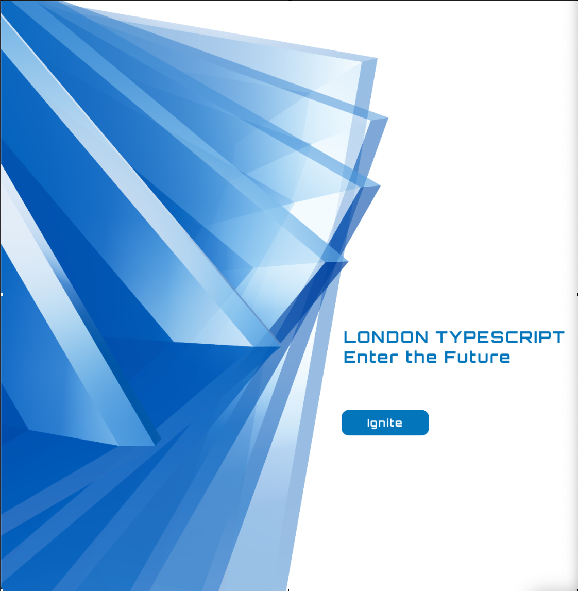
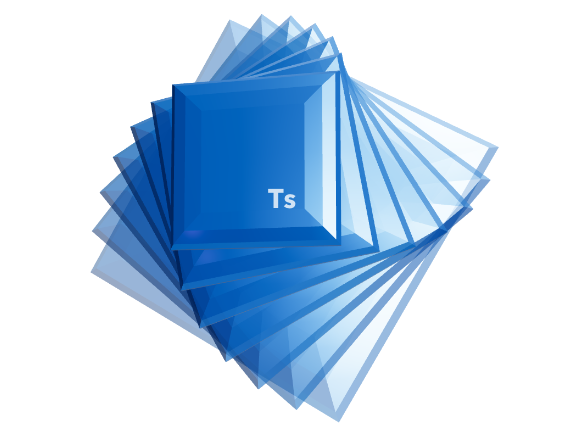
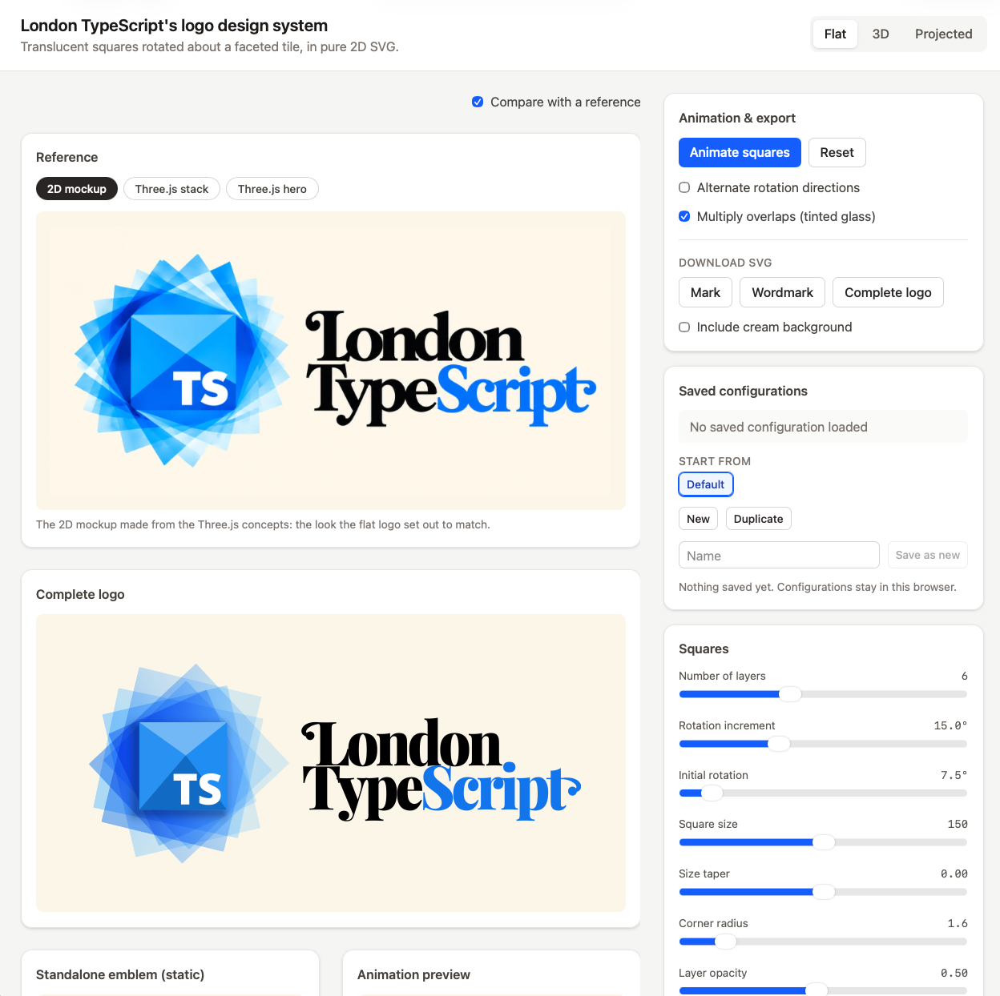

# tate-modern

**London TypeScript's logo design system, with the logo generated entirely in TypeScript.** Its geometry, colours and typography are defined in TypeScript rather than drawn, with the lettering outlined from Open Sans and Playfair Display: one palette, one wordmark and the logo in three renderings. A small studio app tunes them, compares the results side by side, and exports SVG files ready for the web, GitHub and events.

## Where it started

The logo began as a concept sculpture hand-coded in three.js with React Three Fiber: translucent blue slabs fanned behind a "Ts" tile. Each slab is its own bevelled 3D mesh in a metallic blue, three-quarters opaque, and each one rotates independently at its own speed, so the fan opens, closes and shifts as it turns.

A rig of directional lights picks out highlights along the bevelled edges, and a bloom pass gives the glass its glow. A hero-page concept spread the turning fan across the page, beside an Ignite button that scrolls on to the next section.

<table>
  <tr>
    <td align="center" valign="middle" width="50%"></td>
    <td align="center" valign="middle" width="50%"></td>
  </tr>
  <tr>
    <td align="center">The 3D hero</td>
    <td align="center">The 3D logo</td>
  </tr>
</table>

We then made 2D mockups from it, with the "London TypeScript" wordmark beside the emblem. The studio rebuilds both the sculpture and the flat logo in code.

<p align="center"></p>
<p align="center">The 2D mockup the flat logo works towards</p>

## The concepts

Each concept is its own renderer of the same idea, sharing one palette and one wordmark:

| Concept       | What it is                                                                                                           | Exports                             |
| ------------- | -------------------------------------------------------------------------------------------------------------------- | ----------------------------------- |
| **Flat**      | Translucent squares rotated about a faceted tile, rendered as pure 2D SVG and refined against the 2D mockup.         | SVG (the files in `public/assets/`) |
| **3D**        | The original hand-coded sculpture in React Three Fiber, with real lights and reflections.                            | PNG                                 |
| **Projected** | The 3D slabs drawn as flat SVG, shaded with three.js's own lighting maths: a vector logo with the sculpture's depth. | SVG                                 |

The TypeScript source is the design: the SVGs in `public/assets/` are generated from it, never edited by hand.

## The studio

Each concept has its own page in the studio, with live previews, controls, starting points and configurations saved in your browser. Flat exports the mark, wordmark or complete logo as SVG; Projected exports the mark or logo as SVG; 3D exports the sculpture as PNG.

<p align="center"></p>

## Quick start

Requires Node 24 or later and pnpm.

```bash
pnpm install
pnpm dev              # the studio at http://localhost:5173
pnpm test             # unit tests (Vitest)
pnpm build            # regenerate assets, type-check, build the studio
```

## Documentation

- [Using the studio](docs/studio/using-the-studio.md): the controls, saved configurations, the generated assets, and using the components in a website.
- [How the concepts work](docs/studio/concepts.md): the geometry, animation, projection and shading behind each concept, and the shared typography.
- [Code layout](docs/studio/architecture.md): the project structure, adding a concept, fonts and tests.

## Contributing

Changes reach `main` through pull requests only, and every one passes the same checks locally and in CI: type-checking, linting, formatting, tests and the build. The repo runs on [temple-bar](https://github.com/londontypescript/temple-bar), London TypeScript's workflow for people and AI agents alike; [AGENTS.md](AGENTS.md) holds the rules. `pnpm install` switches on the git hooks; `pnpm gate` runs the checks and `pnpm build` the build.

## Why "Tate Modern"

London TypeScript's repositories are named after London landmarks. Tate Modern is London's gallery for modern and experimental art, and this repo is where the meetup's experiments live: prototype designs, tried side by side, that the rest of London TypeScript eventually adopts.

## Licence and credits

[MIT](LICENSE).

- **Fonts:** Open Sans and Playfair Display, both under the SIL Open Font License 1.1, installed from `@fontsource` packages. No font files are committed.
- **three.js:** `src/concepts/projected/engine/shading.ts` ports formulas from three.js's shaders ([MIT](https://github.com/mrdoob/three.js/blob/dev/LICENSE), © 2010-2026 three.js authors).
- **Reference images** (`public/references/`): `three-hero.png` and `three-stack.png` are screenshots of this project's own prototypes; `flat-mockup.webp` is a 2D mockup made from the 3D logo.
