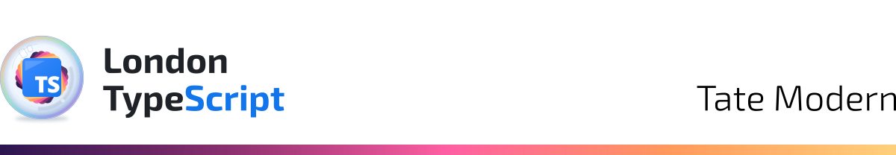
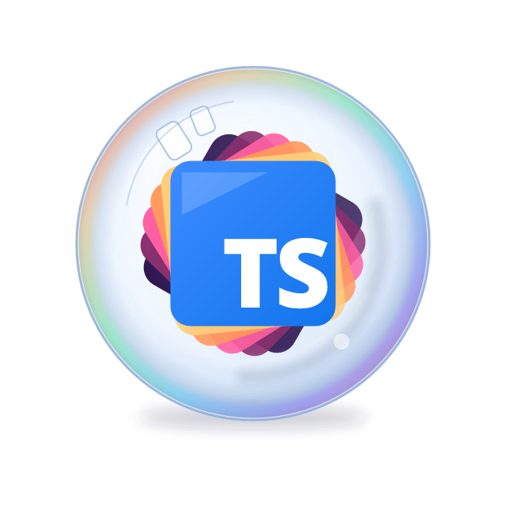
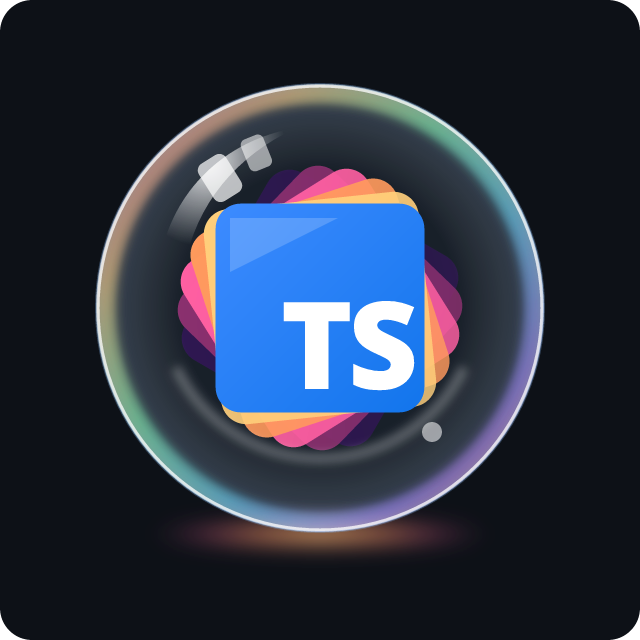
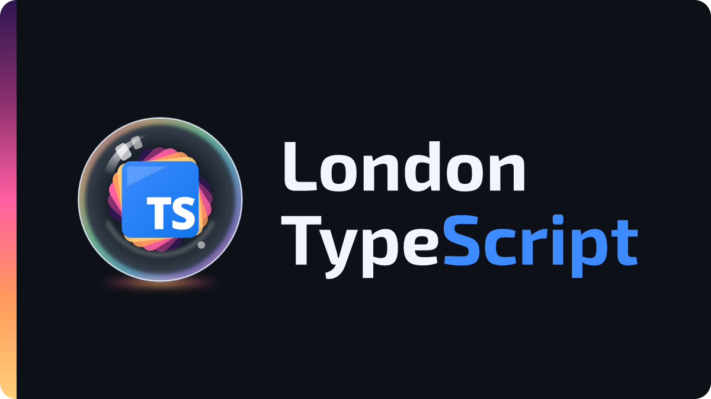
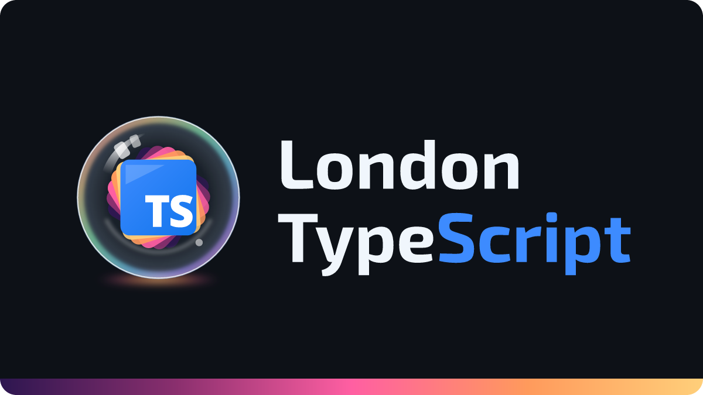
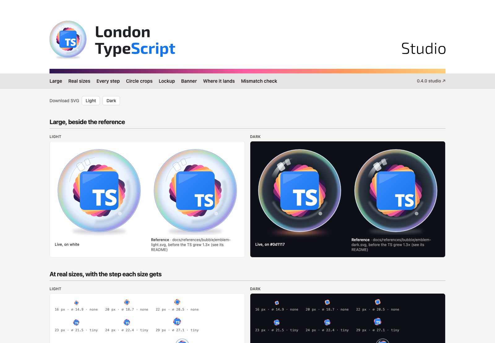
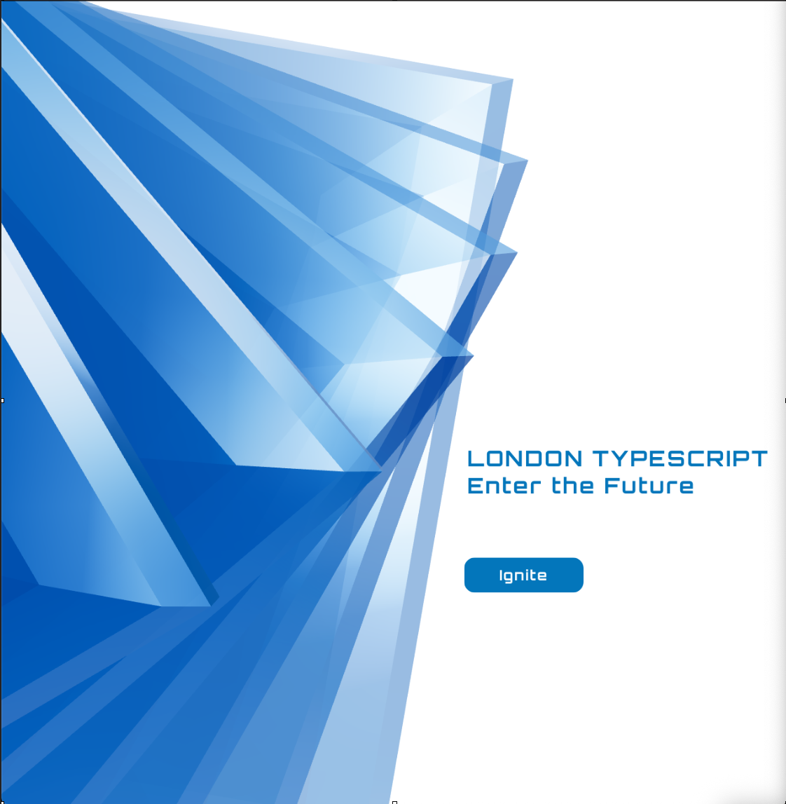
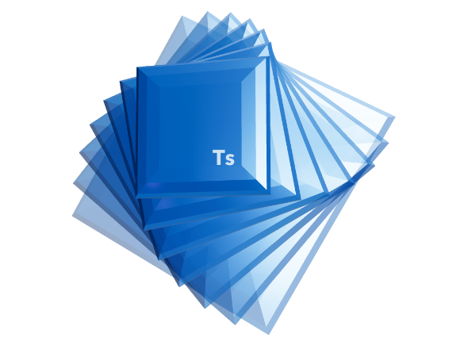
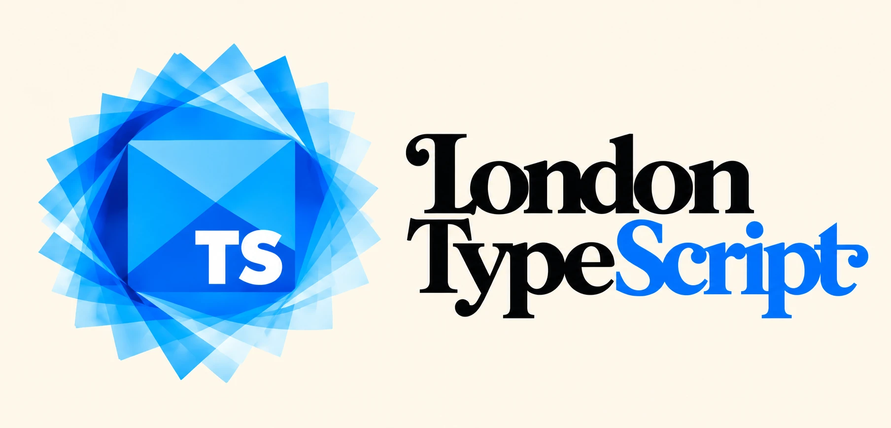

<p>
  <picture>
    <source media="(prefers-color-scheme: dark)" srcset="docs/images/tate-modern-dark-band-bottom-d2231d66.svg">
    
  </picture>
</p>

Tate Modern is London TypeScript’s design studio. It houses our logos, character designs and illustrations, all defined in TypeScript, along with our official design guidelines and colour systems. Its studio apps let you tailor each design and export it in the formats our repos, events and websites need.

## The Bubble

The logo is a glass bubble around the TypeScript tile and a fan of sunset-coloured panes, in a light theme for white pages and a dark one for GitHub's dark page. Smaller sizes get simpler drawings, down to just the tile and a sunset ring for favicons.

<table>
  <tr>
    <td align="center" width="50%"></td>
    <td align="center" width="50%"></td>
  </tr>
  <tr>
    <td align="center">Light, for white pages</td>
    <td align="center">Dark, for GitHub's dark page</td>
  </tr>
</table>

## The Wordmark and Band

"London TypeScript" is set in Exo 2, with "Script" in TypeScript blue. In the studio, the Meetup photo can take a sunset band on any side and rounded corners.

<table>
  <tr>
    <td align="center" width="50%"></td>
    <td align="center" width="50%"></td>
  </tr>
  <tr>
    <td align="center">Band on the left</td>
    <td align="center">Band along the bottom</td>
  </tr>
</table>

## The Studio

`pnpm dev` opens the bubble's studio: the emblem large beside its reference, at real sizes with the step each size gets, every step at every size, the lockup, and each place the logo lands, in both themes, with SVG downloads. Nothing is tuned there; the drawing is changed in code.

<p align="center"></p>

Every file GitHub, Meetup and the website need is exported from the studio, and `pnpm generate:assets` writes the committed set to [`public/assets/`](public/assets/).

The 0.4.0 studio, with the Flat, 3D and Projected concepts, their controls, saved configurations and downloads, is kept unchanged at `legacy.html`, linked from the studio's header. [Using the studio](docs/studio/using-the-studio.md) describes it.

## Quick Start

Requires Node 24 or later and pnpm.

```bash
pnpm install
pnpm dev              # the studio at http://localhost:5173 (0.4.0's at /legacy.html)
pnpm test             # unit tests (Vitest)
pnpm build            # regenerate the assets, type-check, build both studios
```

The repo runs on [temple-bar](https://github.com/londontypescript/temple-bar), London TypeScript's workflow for people and AI agents alike; [AGENTS.md](AGENTS.md) holds the rules.

## Documentation

- [ADR 0004](docs/adr/0004-the-bubble-is-the-logo.md) and [the bubble's reference](docs/references/bubble/README.md): why the bubble is the logo, and the drawings it's judged against.
- [Using the studio](docs/studio/using-the-studio.md): the 0.4.0 studio's controls, saved configurations and downloads, and using its components in a website.
- [How the concepts work](docs/studio/concepts.md): the geometry, animation, projection and shading behind each 0.4.0 concept, and the shared typography.
- [Code layout](docs/studio/architecture.md): the project structure, adding a concept, fonts and tests.

## Where It Started

The logo began as a concept sculpture hand-coded in three.js with React Three Fiber: translucent blue slabs fanned behind a "Ts" tile. Each slab is its own bevelled 3D mesh in a metallic blue, three-quarters opaque, and each one rotates independently at its own speed, so the fan opens, closes and shifts as it turns.

A rig of directional lights picks out highlights along the bevelled edges, and a bloom pass gives the glass its glow. A hero-page concept spread the turning fan across the page, beside an Ignite button that scrolls on to the next section.

<table>
  <tr>
    <td align="center" valign="middle" width="50%"></td>
    <td align="center" valign="middle" width="50%"></td>
  </tr>
  <tr>
    <td align="center">The 3D hero</td>
    <td align="center">The 3D logo</td>
  </tr>
</table>

We then made 2D mockups from it, with the "London TypeScript" wordmark beside the emblem.

<p align="center"></p>
<p align="center">The 2D mockup the flat logo works towards</p>

The 0.4.0 studio rebuilt both in code, as three concepts side by side: **Flat**, the mockup as pure SVG; **3D**, the sculpture in React Three Fiber; and **Projected**, the 3D slabs drawn as flat SVG with three.js's own shading. In October 2026 the flat fan was redrawn as the glass bubble above.

## Why "Tate Modern"

London TypeScript's repositories are named after London landmarks. Tate Modern is London's gallery for modern and experimental art, and this repo is where the meetup's experiments live: prototype designs, tried side by side, that the rest of London TypeScript eventually adopts.

## Licence and Credits

[MIT](LICENSE).

- **Fonts:** Exo 2 (the bubble's wordmark), Open Sans and Playfair Display, all under the SIL Open Font License 1.1, installed from `@fontsource` packages. No font files are committed.
- **three.js:** `src/concepts/projected/engine/shading.ts` ports formulas from three.js's shaders ([MIT](https://github.com/mrdoob/three.js/blob/dev/LICENSE), © 2010-2026 three.js authors).
- **Reference images** (`public/references/`): `three-hero.png` and `three-stack.png` are screenshots of this project's own prototypes; `flat-mockup.webp` is a 2D mockup made from the 3D logo.
