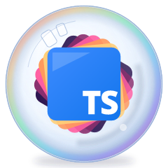
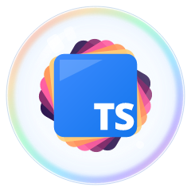

# ADR 0004: The bubble is the logo

Date: 2026-10-30. Status: proposed.

## Context

0.4.0 made the flat concept's look the only default (#49), with Flat, 3D and Projected compared side by side in
one studio. On 29 October 2026 a glass-bubble version was explored outside the repo, as throwaway scripts in the
gitignored `.temple-bar/explorations/2026-10-29-cartoon-logos/`: the flat concept's fan of panes, recoloured as
sunset bands (plum, magenta, pink, orange, gold) behind the blue TS tile, inside a clear glass sphere, with a
wordmark in Exo 2. The maintainer chose it as the London TypeScript logo on 30 October 2026, with the decisions in
issue #55 and the [0.5.0 plan](../plans/0.5.0.md).

That runs into [ADR 0002](0002-concepts-share-one-core.md) twice. ADR 0002 gives every concept one identical
wordmark, shared from `src/shared/wordmark.ts`, and names "a concept that needs a different wordmark" as what would
end it. It also puts every concept in `src/concepts/<name>/`, registered in `src/studio/concepts.ts`, inside one
studio. The bubble needs neither: it has a wordmark of its own, and it is pure SVG from the start, so it needs none
of the old studio's sliders, saved configurations or tuning machinery.

The options for the old studio were to keep extending it, to remove it from `main` and leave the signed `v0.4.0`
release as its frozen copy, or to keep it on a second page. Removing it would mean cutting over the asset generator,
the scorer and their tests together, a delicate change of its own, so it was not taken for 0.5.0.

## Decision

**The sunset bubble is the logo.** The emblem is the exploration's `bubble-panes`: the sunset fan of panes inside the
glass bubble. The blue-fan alternative is not kept. Its canonical light and dark drawings are frozen in
[`docs/references/bubble/`](../references/bubble/README.md), and the TypeScript version is judged against them.

<table>
  <tr>
    <td align="center"></td>
    <td align="center"></td>
  </tr>
  <tr>
    <td align="center">Light</td>
    <td align="center">Dark, drawn for dark backgrounds</td>
  </tr>
</table>

It replaces the 0.4.0 flat logo, shown here from the signed `v0.4.0` release (its black wordmark is drawn for light
backgrounds):

**A new, minimal studio is the main page.** It is built from scratch for the bubble: `index.html`, with its code in
`src/bubble/`. It previews the logo at real sizes in both themes and exports it; tuning happens in code. The 0.4.0
studio (Flat, 3D and Projected, with their sliders and saved configurations) is a previous version, frozen as it is:
it moves to a second page, `legacy.html`, with its source paths unchanged (`src/concepts/`, `src/studio/`), and is
still built and tested. No further work is planned on it.

**Exo 2 is the bubble's wordmark only.** The bubble's lockup sets "London TypeScript" in Exo 2, weight 700. The frozen
concepts keep their own wordmark: Playfair Display 900, from `src/shared/wordmark.ts`. Open Sans 800 stays the TS
tile's lettering, in the frozen concepts and the bubble alike.

**What this replaces in ADR 0002, for the bubble only:**

- **The identical-wordmark invariant**, that every concept shows the same wordmark. The bubble has its own.
- **The concept registry and location rule**, that a concept lives in `src/concepts/<name>/` and is registered in
  `src/studio/concepts.ts`. The bubble lives in `src/bubble/`, outside the registry, with its own studio page.

ADR 0002 still applies, unchanged, to the frozen concepts. Its shared utilities stand, and the bubble reuses them:
the palette, font parsing, `typography.ts`'s glyph layout, and `src/shared/react/standaloneSvg.ts` and
`useOwnIdPrefix.ts`.

A new studio rather than a fourth concept, because the bubble shares nothing with the old studio's machinery but
those utilities, and keeping the old one on its own page costs nothing while removing it would cost a cutover.

## What would end it

A different logo being chosen; the frozen studio being removed from `main`, which would leave the registry rule with
nothing to cover and needs its own decision; or the bubble needing what the old studio's machinery gives, such as
live tuning by sliders, which would argue for folding the two studios back together.
